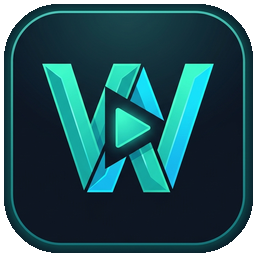

<div align="center">



# Stockage DB

**Serveur de stockage multi-sources, relais vidéo MP4/HLS et API REST de bandes-annonces**

[](#)
[](#)
[](#)
[](#)
[](#)

</div>

---

## Présentation

**Stockage DB** est un serveur backend universel qui **collecte, convertit, met en cache et expose par API des bandes-annonces vidéo en MP4** (Netflix, Apple TV+, liens directs MP4/HLS, instance amont et repli YouTube).

Il fonctionne **100 % en serveur d'API universelle et de relais vidéo** (aucun manifest Stremio embarqué) : n'importe quelle instance externe — addon Stremio comme **[`vf-trailer-wallace`](https://github.com/Wallacecleaver/vf-trailer-wallace)** ou addon tiers, autre serveur **Stockage DB** en cascade, site web, application mobile, bot Discord ou script — peut s'y connecter avec sa propre clé dédiée.

### Points clés

- **API Universelle multi-instances (`/api/v1`)** :
  - Accepte tous les formats d'identifiants sur un seul endpoint (`tt13016388`, `tt13016388:2:1` avec extraction auto de la saison, `tmdb:95396`, `tmdb:tv:95396`, `nflx:81944880`, `81944880`, ou recherche directe `?title=Severance&year=2022`).
  - Authentification compatible avec tous les clients HTTP : `Authorization: Bearer <clé>`, `X-API-Key: <clé>`, `Api-Key: <clé>` ou `?apikey=<clé>`.
  - Jusqu'à **50 clés indépendantes** (`MAX_API_KEYS`) avec quotas, permissions et suivi par instance + **guide public interactif sur `/api/docs`** partageable sans exposer `/admin`.
- **Base SQLite centralisée (mode WAL)** — films et séries avec identifiants croisés (`imdb_id`, `tmdb_id`, `netflix_id`, Apple TV+), synopsis, genres, saisons et bandes-annonces VF/VO.
- **Relais vidéo MP4 prêt à lire** :
  - `/trailer/<id>/<n>.mp4` renouvelle automatiquement les liens signés Netflix lorsqu'ils expirent.
  - `/apple/<id>/<n>.mp4` et `/media/<id>/<n>.mp4` convertissent à la volée les flux HLS (`.m3u8`) en vrai MP4 avec piste audio remuxée via `ffmpeg` et cache disque intelligent.
  - Résolution dynamique de l'URL publique du serveur si `PUBLIC_URL` n'a pas encore été renseigné.
- **Résolution automatique à la demande** — lorsqu'un titre inconnu est demandé à l'API, le serveur le résout automatiquement : *TMDB → JustWatch → Netflix → Apple TV+ → YouTube*.
- **Sécurité intégrée** — clés API hashées en SHA-256 (`sdb_...`) avec pause en 1 clic, rotation, quotas par minute et protection anti-SSRF IPv4/IPv6 sur tous les relais.

> **Migration automatique** : si une ancienne base `./data/netflix.db` est présente, elle est automatiquement migrée vers `./data/stockage.db` au premier démarrage.

---

## Démarrage rapide

### Option 1 — Sur un VPS avec Docker *(recommandé)*

```bash
git clone https://github.com/Wallacecleaver/stockage-db.git
cd stockage-db
cp .env.example .env
```

Renseigne au minimum dans ton fichier `.env` :

```env
ADMIN_TOKEN=un_mot_de_passe_solide_de_16_caracteres_minimum
PUBLIC_URL=https://stockage.mondomaine.fr
TMDB_API_KEY=ta_cle_tmdb
```

Puis lance le conteneur :

```bash
docker compose up -d --build
```

Exemple de reverse proxy HTTPS avec **Caddy** :

```caddyfile
stockage.mondomaine.fr {
    reverse_proxy 127.0.0.1:7000
}
```

### Option 2 — En local (Linux / macOS / Windows)

Prérequis : **Node.js ≥ 20** et **`ffmpeg`** installé dans le `PATH`.

```bash
npm ci
cp .env.example .env      # sous Windows : copy .env.example .env
npm start                 # ouvre http://localhost:7000/admin
```

---

## Connecter n'importe quelle instance externe

1. Ouvre **`https://stockage.mondomaine.fr/admin`** et va dans **API & Connexion Universelle**.
2. Crée une clé dédiée pour l'instance cible (addon Stremio, instance d'un ami, site web, bot…) et choisis son profil d'intégration rapide :
   - **Addon Stremio / Média** (`STOCKAGE_URL` + `STOCKAGE_API_KEY` ou appel direct `/api/v1/trailers/tt13016388:2:1`)
   - **Autre Stockage DB** (`UPSTREAM_URL` + `UPSTREAM_API_KEY` pour chaîner deux serveurs)
   - **App / Site / Bot (REST)** (appels JSON standard avec CORS ouvert)
   - **Bruno / Postman** (import en 1 clic via `/api/v1/openapi.json`)
3. Tu peux aussi partager **`https://stockage.mondomaine.fr/api/docs`** : une page publique interactive permettant à n'importe quel développeur tiers de lire la doc et de tester sa clé `sdb_...` en direct sans accès admin.

---

## Le Dashboard (`/admin`)

Toute l'exploitation quotidienne se fait depuis l'interface web (thème sombre/clair, recherche rapide `Ctrl+K`, aucune étape de build).

### Exploitation

| Onglet | Rôle |
|---|---|
| **Vue d'ensemble** | Couverture vidéo du catalogue, santé des sources, lancement et suivi en direct des tâches de collecte / enrichissement. |
| **Catalogue** | Exploration filtrable et triable des fiches, inspecteur détaillé par saison, export JSON et suppression propre. |
| **Ajouter & Chercher** | Recherche multi-sources (JustWatch, Apple TV+) et ajout manuel par URL/ID Netflix, Prime Video, Apple TV+ ou **lien direct MP4 / `.m3u8`**. |
| **Test des flux** | Lecteur vidéo intégré + **sonde serveur réelle** (code HTTP, validation de l'en-tête MP4 `ftyp`, taille, latence en `ms`) + diagnostic rapide de 6 flux au hasard. |

### Intégration & Système

| Onglet | Rôle |
|---|---|
| **API & Connexion Universelle** | Tuiles d'intégration rapide, URLs universelles copiables en 1 clic, gestion multi-instances (jusqu'à 50 clés `sdb_...`), trafic en direct et lien `/api/docs`. |
| **Paramètres & HLS** | Réglages persistés en base SQLite, gestion du cache disque HLS, optimisation WAL et téléchargement de sauvegarde `.db` à chaud. |
| **Journal** | Historique filtrable des 2 000 derniers événements serveur (`info`, `warn`, `error`, appels API et relais). |

> **Priorité des réglages** : toute valeur enregistrée dans l'onglet **Paramètres & HLS** est stockée dans SQLite et survit aux redéploiements (*Dashboard > `.env` > valeur par défaut*).

---

## Alimenter et enrichir la base

Les tâches peuvent être lancées **en 1 clic depuis la Vue d'ensemble** ou en ligne de commande :

```bash
# 1. Collecter les identifiants de titres
npm run harvest                          # tout le catalogue Netflix multi-pays (JustWatch)
npm run harvest:recent                   # uniquement les sorties récentes
npm run sync                             # synchronisation populaire / récente via TMDB

# 2. Extraire les bandes-annonces MP4 des pages Netflix
npm run netflix-trailers                 # reprise automatique, arrêtable à tout moment
npm run netflix-trailers -- --limit 100  # par lot pour tester

# 3. Compléter les identifiants IMDb, affiches et replis VF
npm run netflix-ids                      # associe nom -> ID Netflix via JustWatch
npm run vf                               # enrichit via TMDB (ID IMDb, synopsis, YouTube VF)
```

---

## API REST Universelle (`/api/v1`)

Par défaut, **l'API est fermée** tant qu'aucune clé active n'existe (`403`).
Chaque clé `sdb_...` peut être transmise au choix via :
- `Authorization: Bearer <clé>`
- `X-API-Key: <clé>` ou `Api-Key: <clé>`
- Paramètre d'URL `?apikey=<clé>` (pratique pour les addons et lecteurs qui ne personnalisent pas leurs en-têtes HTTP)

### Routes disponibles

| Méthode | Route | Permission | Description |
|---|---|---|---|
| `GET` | `/health` | Public | État du serveur, version, uptime et nombre de titres (Docker / Uptime Kuma). |
| `GET` | `/api/v1` · `/.well-known/stockage-db.json` | Public | Découverte JSON auto-descriptive (endpoints, formats d'IDs, méthodes d'auth, capacités). |
| `GET` | `/api/docs` | Public | Documentation interactive universelle + testeur de clé `sdb_...` en direct. |
| `GET` | `/api/v1/openapi.json` | Public | Spécification **OpenAPI 3.0.3** importable dans Bruno, Postman ou Hoppscotch. |
| `GET` | `/api/v1/status` | Lecture | Statut détaillé des sources, du cache et des capacités serveur. |
| `GET` | `/api/v1/trailers/:id` | Lecture | Endpoint universel direct (`tt13016388`, `tt13016388:2:1`, `tmdb:95396`, `nflx:81944880`…). |
| `GET` | `/api/v1/trailers` | Lecture | Recherche de bandes-annonces par paramètres (`id`, `imdb`, `tmdb`, `netflix`, `title` + `year`, `season`, `strict_season=1`, `fast=1`). |
| `POST` | `/api/v1/trailers/batch` | Lecture | Récupération groupée jusqu'à **25 titres ou saisons** en une seule requête HTTP. |
| `POST` | `/api/v1/prewarm` | Lecture | Préchauffage asynchrone (`202 Accepted`) d'une liste de titres en tâche de fond. |
| `GET` | `/api/v1/search` | Lecture | Recherche plein texte dans le catalogue local (`q`, `type`, `filter`, `limit`). |
| `GET` | `/api/v1/title/:id` | Lecture | Fiche complète par ID universel (IMDb, TMDB, Netflix ou interne) + saisons disponibles. |
| `POST` | `/api/v1/trailers/submit` | Écriture | Ajoute une bande-annonce MP4 ou HLS (`.m3u8`) à distance sur une fiche. |

> Les routes courtes `/api/status`, `/api/trailers` et `/api/trailers/:id` restent actives comme alias de `/api/v1/*` pour une compatibilité totale.

### Exemples d'appels universels

```bash
# 1. Par ID composite Stremio (extrait automatiquement type=series & season=2)
curl -H "Authorization: Bearer sdb_votre_cle" \
  "https://stockage.mondomaine.fr/api/v1/trailers/tt13016388:2:1?strict_season=1"

# 2. Par identifiant TMDB (film ou série)
curl -H "X-API-Key: sdb_votre_cle" \
  "https://stockage.mondomaine.fr/api/v1/trailers/tmdb:tv:95396"

# 3. Par titre + année (sans aucun identifiant externe)
curl "https://stockage.mondomaine.fr/api/v1/trailers?title=Severance&year=2022&apikey=sdb_votre_cle"
```

---

## Sources vidéo & qualités

| Source | Route de relais | Fonctionnement | Qualité typique |
|---|---|---|---|
| **Netflix** | `/trailer/<nid>/<n>.mp4` | Lien MP4 signé en clair, rafraîchi automatiquement à l'expiration | `768×432` |
| **Apple TV+** | `/apple/<id>/<n>.mp4` | Flux HLS non chiffré remuxé en MP4 (vidéo + audio) par `ffmpeg` | Jusqu'à `720p` (`HLS_MAX_HEIGHT`) |
| **Lien direct** | `/media/<id>/<n>.mp4` | Toute URL publique `.mp4` ou `.m3u8` rattachée à une fiche (Arte, distributeur…) | Qualité d'origine |
| **YouTube** | Lien externe `ytId` | Repli via TMDB ou recherche VF filtrée (`YOUTUBE_AS_SOURCE=1` pour l'inclure systématiquement) | Jusqu'à `1080p` |

> **Note sur les DRM** : le serveur ne contourne aucun chiffrement DRM. Les flux protégés (Prime Video, Disney+, Max) ne sont pas relayables ; seules leurs métadonnées et bandes-annonces publiques sont exploitées.

---

## Configuration (`.env`)

### Variables principales

| Variable | Défaut | Description |
|---|---|---|
| `ADMIN_TOKEN` | *(requis)* | Mot de passe administrateur de `/admin` (minimum 16 caractères recommandé). |
| `PUBLIC_URL` | `http://localhost:7000` | URL publique du serveur utilisée pour construire les liens `/trailer/...`, `/apple/...` et `/media/...`. |
| `TMDB_API_KEY` | *(vide)* | Clé TMDB v3 ou jeton v4 — active la synchro, le liage IMDb et la résolution à la demande. |
| `PORT` | `7000` | Port d'écoute HTTP du serveur Node.js. |
| `DB_PATH` | `./data/stockage.db` | Emplacement du fichier SQLite principal. |
| `TRUST_PROXY_HOPS` | `1` | Nombre de reverse proxies de confiance devant l'application (`1` derrière Caddy/Nginx). |

<details>
<summary><strong>Afficher toutes les variables avancées (Catalogues, Apple TV+, HLS, Fédération)</strong></summary>

<br>

| Variable | Défaut | Description |
|---|---|---|
| `REGION` / `TMDB_LANG` / `NETFLIX_COUNTRY` | `FR` / `fr-FR` / `fr` | Pays et langues utilisés pour TMDB et Netflix. |
| `CATALOG_PROVIDERS` | `8,337` | Plateformes synchronisées via TMDB (`8` Netflix, `337` Apple TV+, `2` Apple TV, `119` Prime Video, ou `all`). |
| `HARVEST_COUNTRIES` | `FR,US,GB,CA` | Pays parcourus lors du moissonnage Netflix JustWatch. |
| `SYNC_PAGES` / `SYNC_EVERY_HOURS` | `5` / `24` | Profondeur et intervalle de synchronisation automatique TMDB. |
| `NETFLIX_REFRESH_HOURS` | `4` | Délai avant relecture d'une page Netflix pour détecter une nouvelle saison ou bande-annonce. |
| `RESOLVE_ENABLED` | `1` | Active (`1`) ou désactive (`0`) la résolution automatique des titres inconnus. |
| `APPLETV_ENABLED` | `1` | Active la recherche et conversion des bandes-annonces Apple TV+. |
| `HLS_CACHE_DIR` | `./data/hls` | Dossier du cache disque des vidéos HLS converties en MP4. |
| `HLS_MAX_HEIGHT` / `HLS_MAX_MB` | `720` / `60` | Résolution maximale et taille plafond d'un MP4 converti depuis HLS. |
| `HLS_CACHE_DAYS` / `HLS_MAX_DISK_MB` | `7` / `2048` | Durée de rétention (jours) et quota disque total (Mo) du cache HLS. |
| `HLS_MAX_CONCURRENT` | `2` | Nombre maximal de conversions `ffmpeg` simultanées. |
| `FFMPEG_PATH` | *(auto)* | Chemin explicite vers le binaire `ffmpeg` s'il n'est pas dans le `PATH`. |
| `YOUTUBE_SEARCH` / `YOUTUBE_AS_SOURCE` | `1` / `0` | Recherche YouTube de secours (`1`) et ajout systématique aux côtés des flux MP4 (`0`/`1`). |
| `UPSTREAM_URL` / `UPSTREAM_API_KEY` | *(vide)* | Autre instance Stockage DB amont interrogée en cascade. |
| `ALLOW_OPEN_API` | *(vide)* | `1` ouvre l'API en lecture sans clé (déconseillé en production). |
| `ALLOW_PRIVATE_URLS` | *(vide)* | `1` autorise les adresses privées/locales dans le relais (réseau Docker interne uniquement). |

</details>

---

## Tests & Diagnostic

```bash
# Suite complète (parseurs, fusion SQLite, anti-SSRF IPv4/IPv6, relais MP4, sonde de flux, API v1 et dashboard)
npm test

# Sous-suites ciblées
npm run test:search
npm run test:youtube

# Diagnostic CLI d'une fiche en base ou sur une instance distante
npm run api-check -- tt13016388
npm run api-check -- tt13016388 --url https://stockage.mondomaine.fr --key sdb_votre_cle
```

---

## Dépannage rapide

| Symptôme | Solution |
|---|---|
| `/admin` renvoie `503` | Ajoute `ADMIN_TOKEN=...` dans ton fichier `.env` puis redémarre le serveur. |
| L'API renvoie `401` ou `403` | Crée une clé dans **API & Connexion** et vérifie qu'elle n'est pas **En pause (`⏸`)**. |
| Une vidéo ne se lance pas côté client | Vérifie que `PUBLIC_URL` correspond bien à l'URL HTTPS publique du serveur, puis teste le titre dans **Exploitation → Test des flux**. |
| Bandes-annonces Apple TV+ sans son | Vérifie que `ffmpeg` est bien installé (déjà inclus dans l'image `Dockerfile` officielle). |
| Recherche Apple TV+ en erreur `400` | Mets à jour `APPLETV_API_VERSION`, `APPLETV_UTSCF` et `APPLETV_UTSK` dans **Paramètres & HLS** depuis une requête réseau `tv.apple.com`. |

---

## Architecture du dépôt

```text
stockage-db/
├── src/
│   ├── index.js             # Démarrage HTTP + planificateur de synchro
│   ├── app.js               # Routes Express : API universelle v1, relais vidéo, sonde MP4, admin
│   ├── admin.html           # Dashboard d'administration complet (SPA sans build)
│   ├── api-docs.html        # Documentation publique interactive & testeur de clé (/api/docs)
│   ├── logo.png / logo.svg  # Logo personnalisé W (dashboard & favicons)
│   ├── db.js                # Couche SQLite (WAL, migrations, index, clés API, backup)
│   ├── federation.js        # Résolution des flux relayables & filtrage par saison
│   ├── security.js          # Protection anti-SSRF IPv4/IPv6, CSP, rate-limiting
│   ├── hls.js               # Conversion HLS -> MP4 via ffmpeg + cache disque borné
│   ├── netflix.js           # Extraction des pages et liens vidéo Netflix
│   ├── appletv.js           # Recherche et flux bandes-annonces Apple TV+
│   ├── tmdb.js              # Métadonnées, IDs IMDb et vidéos TMDB
│   ├── justwatch.js         # Moissonnage et correspondance d'IDs Netflix
│   ├── resolve.js           # Résolution automatique à la volée d'un titre inconnu
│   └── enrich.js / link.js  # Fusion sans perte et liaison des identifiants
├── scripts/                 # Outils CLI (harvest, sync, netflix-trailers, vf, api-check…)
├── test/                    # Tests unitaires et d'intégration HTTP/SQLite
├── Dockerfile               # Image Node 22 slim + ffmpeg (utilisateur non-root)
└── docker-compose.yml       # Déploiement clé en main avec volume persistant ./data
```

---

## Mentions

Usage personnel et modéré. Ce projet utilise l'API TMDB mais n'est ni approuvé ni certifié par TMDB.
